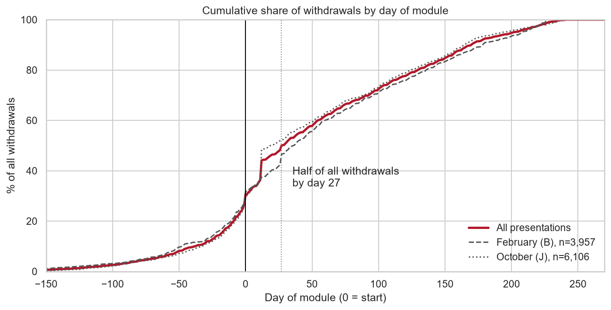
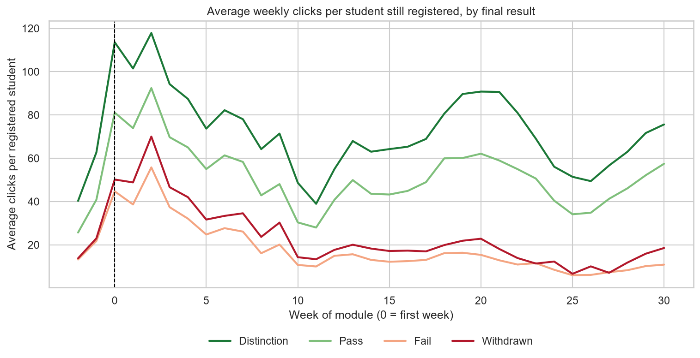
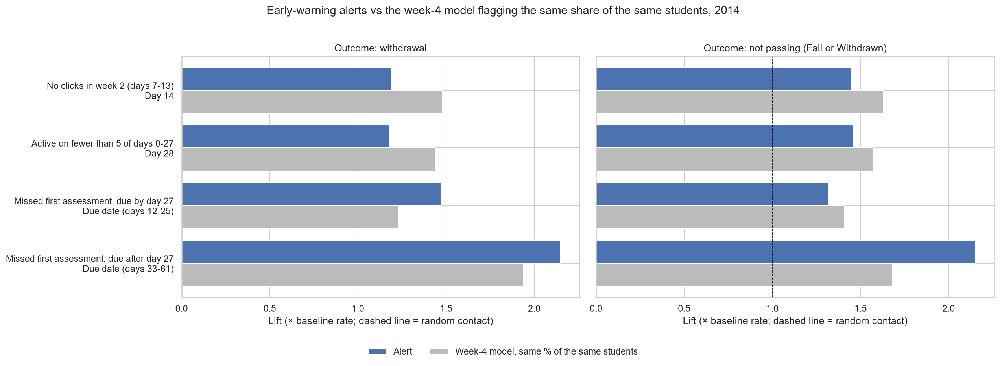

# Why Do Online Learners Drop Out?

A retention analysis of **32,593 enrolments (28,785 students)** on the Open University's online learning platform, using Python. It looks at who withdraws, when, what early behaviour signals the risk, and how well a simple early-warning alert could work.

📓 **[Read the full analysis notebook](Online%20Learner%20Dropout%20-%20Exploratory%20Analysis.ipynb)**

## Purpose

An edtech retention team wants to know which students are likely to withdraw, and how early the warning signs show up. If students are treated as customers, withdrawal is churn and clicks in the learning platform are product engagement. The analysis answers that question and then tests practical alert rules the team could run, using only information the team would have at the time.

## Key findings

- **31.2% of enrolments ended in withdrawal, and about half of those happened by day 27** (50%, or 46% excluding a one-day spike in October 2014). 26.3% left before the module even started, so no week-4 alert can reach them.
- **Early engagement separates passing from not passing, but not withdrawal from failure.** Among students still registered on day 27, those who later withdrew had a median of 143 clicks in the first four weeks vs 217 for students with a Pass, but students who stayed and failed were even less active (103).
- **Missing the first-assessment deadline is the best early warning for withdrawal.** Where it's due by day 25 (2014 data), it flags 39% of students, 32.5% of whom go on to withdraw: 1.47× the baseline, against 1.23× for a week-4 model flagging the same share of the same students (gap +0.20, 95% bootstrap interval +0.13 to +0.26). It catches a quarter of all 2014 withdrawals, up to two weeks before week 4. Students who never submit are the highest risk: only 4.8% pass.
- **A week-4 model works better for "not passing" than for withdrawal alone.** ROC AUC is 0.713 vs 0.614, and 70.5% of the riskiest 20% didn't pass (43.7% baseline). Neither model is strong, so both are best used to prioritise outreach.
- **Workload is the biggest background risk.** Withdrawal doubles from 25.4% for students taking 60 credits or fewer to 51.3% for those taking over 120.







## Recommendations for the retention team

1. **Act before the start and in week 1.** About half of withdrawals happen by day 27, beyond the reach of any week-4 alert. A welcome or check-in contact for all new students, prioritising heavy credit loads, targets the biggest share of the problem.
2. **Treat a missed first-assessment deadline as a priority alert**, with contact within days. Late submitters still pass 46.7% of the time, while students who never submit almost never do (4.8%), so a second check about a week later can separate students who are just behind from those who have stopped.
3. **At week 4, flag students at risk of *not passing* rather than of withdrawal alone**, and let the follow-up decide whether each student needs help staying enrolled or study support.
4. **Check workload at registration.** Students taking over 120 credits withdraw at twice the rate of those taking 60 or fewer. This is a correlation, not proof of cause, but it's a cheap thing to check at sign-up.
5. **Don't rely on simple activity thresholds.** "No clicks in week 2" and "fewer than 5 active days" barely beat random contact for withdrawal (about 1.2× lift) and fall below the model on the same students.

## How the analysis guards against common pitfalls

- **Survivorship:** engagement is compared among students still registered at each point, so students who have already left don't drag averages down. (In the latest weeks, the remaining withdrawers are only those who leave late, so the group's make-up still shifts over time.)
- **Leakage:** the week-4 model is designed to use only information available by day 27, and a missed assessment counts late submissions as missed, because that's all the team can see on the due date.
- **Out-of-time validation:** the model is trained on 2013 and tested on 2014, and also evaluated on modules seen in both years.
- **Like-for-like comparisons:** every alert is measured with precision, baseline, lift and recall, for both withdrawal and not passing, and compared with the model **flagging the same share of the same students**. The headline gap has a 95% bootstrap interval.
- **Data checks:** a spike of 723 withdrawals on day 12 of the October 2014 presentations is flagged as a likely administrative event (cause not confirmed); 90% of missing deprivation bands are in two regions; 493 first-assessment scores banked from earlier attempts are counted as on time.

## Data

[Open University Learning Analytics Dataset (OULAD)](https://analyse.kmi.open.ac.uk/open_dataset), licensed CC-BY 4.0: 22 module presentations from 2013–2014, with demographics, assessment results and about 10.6 million daily summaries of clicks in the virtual learning environment.

Kuzilek, J., Hlosta, M. & Zdrahal, Z. (2017). [Open University Learning Analytics dataset](https://www.nature.com/articles/sdata2017171). *Scientific Data* 4, 170171.

The raw files are not included in this repository (`studentVle.csv` alone is about 430 MB). Download the zip from the link above and unzip the seven CSV files into `data/raw/`.

## Repository structure

```
online-learner-dropout-analysis/
├── Online Learner Dropout - Exploratory Analysis.ipynb   # the full analysis, 10 sections
├── figures/                                             # charts saved by the notebook
├── data/raw/                                            # OULAD CSVs (not committed)
├── requirements.txt
└── README.md
```

## Notebook sections

1. Loading the data
2. Who are the students?
3. What happens to them by the end of the course?
4. When do students withdraw?
5. Does early engagement tell us who will leave?
6. Which learning activities matter most?
7. Does background raise the risk of withdrawing?
8. Does the first assessment predict the final result?
9. Can we flag at-risk students by the end of week 4?
10. Do simple alert rules work?

Followed by conclusions, recommendations and caveats.

## How to run

Requires Python 3.11+ and pandas 3.x (the analysis was run with Python 3.14 and pandas 3.1).

```bash
python -m venv .venv
.venv\Scripts\activate            # Windows  (macOS/Linux: source .venv/bin/activate)
pip install -r requirements.txt
```

Put the OULAD CSVs in `data/raw/`, open the notebook and run all cells.

## Caveats

- The data is from 2013–2014 at one UK distance-learning university, so these are patterns, not current benchmarks.
- "Withdrew" in the engagement and model sections means "withdrew later", among students still registered at that point.
- All results come from a single 2013→2014 split; only the headline alert-vs-model gap has a bootstrap interval.
- February and October presentations are compared only in the withdrawal-timing section, not in the model and alert sections.
- The missed-assessment alert fires on its due date (days 12–25) and the model on day 28, so they don't act on the same information: the comparison shows which is more useful to a retention team, not which method is better.
- The model is a simple, interpretable baseline (logistic regression), and module CCC appears only in the 2014 test year.
- Clicks measure activity, not learning.

## Tech

Python · pandas · NumPy · Matplotlib · Seaborn · scikit-learn · Jupyter
